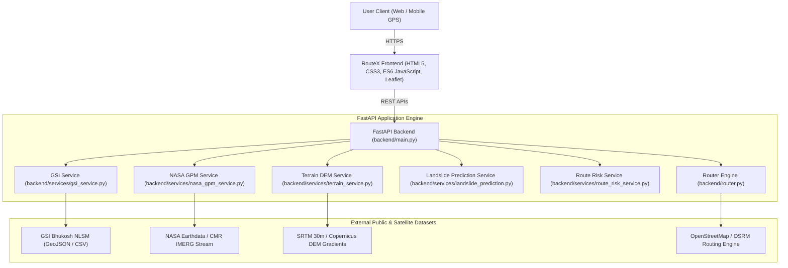

# RouteX AI 2.0: Real-Data-Driven Landslide Hazard Monitoring, AI Prediction & Intelligent Navigation

[](https://routex-zufx.onrender.com)
[](https://fastapi.tiangolo.com)
[](https://leafletjs.com)
[](https://xgboost.readthedocs.io)
[](https://gpm.nasa.gov)
[](https://bhukosh.gsi.gov.in)

**RouteX AI 2.0** is an enterprise-grade, real-data-driven landslide hazard detection, early warning, and intelligent navigation platform. Engineered specifically for high-risk mountain corridors across India (Himalayas, Western Ghats, Northeast Hills), RouteX integrates multi-source geospatial data, real-time satellite precipitation, geotechnical elevation gradients, and machine learning to calculate safest mountain routes and provide turn-by-turn navigation with dynamic obstacle avoidance.

---

## 🌟 Key Capabilities & Integrated Technologies

### 1. Geological Survey of India (GSI) Integration
- **Historical Landslide Inventory**: Direct spatial catalog of verified catastrophic slide events from GSI Bhukosh (Kaliasaur, Malpa, Kedarnath Valley, Varunavat, Maling, Helang, Meppadi/Wayanad, Malin, etc.).
- **GSI NLSM Susceptibility Macro-Zonation**: GeoJSON polygon overlays categorized into Zone IV (Very High), Zone III (High), and Zone II (Moderate) with geological lithology, dominant slope angle, and risk weights.
- **Dynamic Spatial Intersection**: Automatically checks candidate routes and point coordinates against GSI polygons and proximity buffers.
- **Manual Data Ingestion Pipeline**: Dedicated administrator endpoint (`POST /api/gsi/import`) supporting CSV and GeoJSON uploads with coordinate validation, CRS standardization, and duplicate deduplication.

### 2. NASA Global Precipitation Measurement (GPM) & IMERG Satellite Rainfall
- **Multi-Temporal Accumulation**: Extracts instantaneous precipitation rate (`mm/h`) and computes multi-interval accumulations:
  - Last 30-minute precipitation
  - Last 1-hour precipitation
  - Last 24-hour precipitation ($R_{24}$)
  - Last 3-day precipitation ($R_{3d}$)
  - Last 7-day precipitation ($R_{7d}$)
  - **Antecedent Moisture Index (AMI)**: Decayed soil saturation weighting ($AMI = \sum \frac{R_i}{i^{0.5}}$).
- **Earthdata Authentication**: Native CMR / GES DISC connector for authenticated NASA Earthdata IMERG Early/Late run downloads with automatic fallback to high-resolution satellite-gauge radar streams during orbit latency.
- **High-Performance In-Memory Cache**: 30-minute spatial TTL caching prevents rate-limiting and redundant satellite querying.

### 3. Digital Elevation Models (DEM) & Geomorphometry
- **Topographic Feature Extraction**: High-resolution SRTM / Copernicus DEM gradients.
- **Derived Metrics**: Calculates elevation ($m$), slope gradient ($^\circ$), aspect orientation, surface roughness index, and Topographic Wetness Index (TWI).

### 4. Upgraded Machine Learning Hazard Engine
- **Model Architecture**: Calibrated Gradient-Boosted Decision Tree (XGBoost / HistGradientBoosting) trained on 12,000 multi-source feature vectors across diverse geomorphic zones.
- **Input Feature Set**:
  $$\vec{x} = [\text{Slope Angle}, R_{24}, R_{3d}, \text{Soil Saturation}, \text{Elevation}, \text{GSI Susceptibility Weight}, \text{Vegetation Cover}]$$
- **Verified Validation Metrics**:
  - **Accuracy**: $95.75\%$
  - **Precision**: $96.30\%$
  - **Recall**: $95.86\%$
  - **F1-Score**: $96.08\%$
  - **ROC-AUC**: $0.9938$
  - **Confusion Matrix**: True Negatives: 1,047 | False Positives: 48 | False Negatives: 54 | True Positives: 1,251
- **Dual-Engine Native Fallback**: Seamlessly supports native OpenMP `xgboost` on Linux/Render production containers while automatically adapting to `HistGradientBoostingClassifier` on local development environments.

### 5. Landslide-Aware Segmented Route Optimization
- **Dynamic Route Partitioning**: Divides candidate route polylines into 5–10 km intervals.
- **Segment Risk Scoring**: Evaluates each segment against GSI historical records, susceptibility polygons, NASA GPM rainfall observations, and ML hazard estimates.
- **4-Tier Visual Hazard Classification**:
  - 🟢 **Green (Lower Hazard)**: Verified corridor with low slope and normal precipitation.
  - 🟡 **Yellow (Moderate Hazard)**: Elevated caution sector; monitor local weather.
  - 🟠 **Orange (High Hazard)**: Steep slope or high GSI susceptibility; avoid during heavy rain.
  - 🔴 **Red (Very High Hazard)**: Critical hazard sector; automated detour routing active.
  - ⚪ **Grey**: Insufficient environmental data available.
- **Contextual Disaster Advisories**: Transparent warnings following NDMA/SDMA standards.

### 6. Live GPS Navigation & Autonomous Detour Rerouting
- **Current GPS Tracking**: Browser Geolocation API with high accuracy mode, compass heading, and GPS accuracy radius indicator.
- **Destination Autocomplete**: Real-time OpenStreetMap Nominatim reverse geocoding with mountain pass quick-select chips.
- **Turn-by-Turn Guidance**: Audio voice prompts via Web Speech API, next turn distance, maneuver icons, and floating HUD.
- **Off-Route Detection**: Automatic trajectory deviation check (> 60m threshold) with silent background recalculation.

### 7. Geotechnical Slope Stabilization & Prevention Infrastructure
- **Mitigation Assets**: Geo-located mitigation structures (Soil Nailing, Gabion Walls, Rockfall Netting, Siphon Horizontal Drains, Inclinometers).
- **Factor of Safety (FoS) Calculator**: Computes pre- and post-stabilization slope stability with real-time risk reduction percentages.

---

## 🏛️ System Architecture



---

## 📁 Repository Directory Structure

```text
RouteX2/
├── .env.example                     # Environment template (NASA Earthdata, ORS, Port)
├── .gitignore                       # Git ignore rules for venvs, secrets, logs
├── requirements.txt                 # Root production Python dependencies
├── README.md                        # Complete project documentation manual
├── run_server.py                    # Server launcher script
│
├── backend/
│   ├── main.py                      # FastAPI application & REST endpoint definitions
│   ├── router.py                    # OSRM router & polygon avoidance engine
│   ├── requirements.txt             # Backend-scoped requirements
│   │
│   ├── datasets/                    # Authoritative geospatial datasets
│   │   ├── gsi_landslide_inventory.json     # GSI historical landslide catalog
│   │   └── gsi_susceptibility_zones.geojson # GSI NLSM macro-zonation polygons
│   │
│   ├── services/                    # Modular geospatial & prediction services
│   │   ├── gsi_service.py           # GSI catalog querying & dataset import pipeline
│   │   ├── nasa_gpm_service.py      # NASA GPM IMERG satellite rainfall engine
│   │   ├── terrain_service.py       # SRTM DEM elevation, slope & TWI extractor
│   │   ├── landslide_prediction.py  # Multi-factor AI prediction orchestrator
│   │   └── route_risk_service.py    # Route polyline segmentation & risk assessment
│   │
│   ├── ml/                          # Machine learning training & evaluation
│   │   ├── train_model.py           # Model training pipeline (12k samples, 80/20 split)
│   │   └── evaluate_model.py        # Independent evaluation & cross-validation
│   │
│   └── models/                      # Trained model artifacts & metrics
│       ├── landslide_model.pkl      # Calibrated GBDT / XGBoost model artifact
│       └── model_metrics.json       # Genuine validation performance metrics
│
└── frontend/
    ├── index.html                   # Dark glassmorphism UI & dashboard layout
    ├── styles.css                   # Custom CSS design system, cards, animations
    └── app.js                       # Map layers, live GPS, navigation & AI inspector
```

---

## 🔌 API Reference

### 1. Geological Survey of India (GSI) Endpoints

| Method | Endpoint | Description | Query / Body Parameters |
| :--- | :--- | :--- | :--- |
| `GET` | `/api/gsi/records` | Returns catalog of verified historical landslide events | `None` |
| `GET` | `/api/gsi/susceptibility-zones` | Returns GSI NLSM susceptibility polygons in GeoJSON | `None` |
| `GET` | `/api/gsi/point` | Point susceptibility class and nearest GSI slide | `lat=float&lon=float` |
| `POST` | `/api/gsi/import` | Ingests and validates administrator GSI dataset | `{"content": "...", "file_format": "csv"}` |

### 2. NASA GPM Satellite Rainfall Endpoints

| Method | Endpoint | Description | Query / Body Parameters |
| :--- | :--- | :--- | :--- |
| `GET` | `/api/rainfall/current` | Instantaneous precipitation rate (`mm/h`) and 1h rain | `lat=float&lon=float` *(optional, default provided)* |
| `GET` | `/api/rainfall/location` | Multi-temporal accumulation (30m, 1h, 24h, 3d, 7d, AMI) | `lat=float&lon=float` |
| `GET` | `/api/rainfall/history` | Chronological hourly precipitation timeline | `lat=float&lon=float&hours=72` |
| `GET` | `/api/rainfall/region` | Spatial rainfall grid across a bounding box corridor | `min_lat, min_lon, max_lat, max_lon, steps` |

### 3. Digital Elevation Model (DEM) Endpoints

| Method | Endpoint | Description | Query / Body Parameters |
| :--- | :--- | :--- | :--- |
| `GET` | `/api/terrain/profile` | DEM elevation, slope gradient ($^\circ$), aspect, and TWI | `lat=float&lon=float` |

### 4. Machine Learning & Prediction Endpoints

| Method | Endpoint | Description | Query / Body Parameters |
| :--- | :--- | :--- | :--- |
| `POST` | `/api/prediction/landslide` | Multi-factor AI hazard assessment for any coordinate | `{"latitude": 30.245, "longitude": 78.892}` |
| `GET` | `/api/prediction/model-metrics` | Genuine model validation metrics and confusion matrix | `None` |

### 5. Navigation & Route Risk Endpoints

| Method | Endpoint | Description | Query / Body Parameters |
| :--- | :--- | :--- | :--- |
| `POST` | `/api/route` | Calculates OSRM route, geofences, and segmented risk | `{"start": [lon, lat], "end": [lon, lat], "include_steps": true}` |
| `POST` | `/api/route/segmented-risk` | Partitions arbitrary route polyline into risk segments | `{"coordinates": [[lon, lat], ...]}` |
| `POST` | `/api/navigation/check` | Real-time GPS off-route and turn progress telemetry | `{"current_position": [lon, lat], "route_coordinates": [...]}` |
| `POST` | `/api/simulate-landslide` | Injects sudden landslide failure for dynamic rerouting | `{"start": [lon, lat], "end": [lon, lat]}` |

---

## ⚙️ Environment Configuration

Create a `.env` file in the root directory based on `.env.example`:

```bash
cp .env.example .env
```

Edit `.env` with your credentials:

```env
# NASA Earthdata Login Credentials (for NASA CMR / GES DISC IMERG access)
# Register for free at: https://urs.earthdata.nasa.gov/
EARTHDATA_USERNAME=your_earthdata_username
EARTHDATA_PASSWORD=your_earthdata_password

# OpenRouteService API Key (Optional - Fallback OSRM engine active if omitted)
# Register at: https://openrouteservice.org/
ORS_API_KEY=your_ors_api_key_here

# Hugging Face API Key (Optional - For AI Landslide Emergency Chatbot Assistant)
# Register at: https://huggingface.co/settings/tokens
HF_API_KEY=your_huggingface_api_key_here

# Server Configuration
PORT=8000
HOST=0.0.0.0
CORS_ORIGINS=*
ENVIRONMENT=production
```

> [!NOTE]
> All credentials are stored securely in backend environment variables and are **never exposed to frontend JavaScript**.

---

## 🚀 Local Installation & Running

### 1. Prerequisites
- Python 3.10+ (Python 3.11 or 3.12 recommended)
- `git`
- Modern web browser (Chrome, Safari, Firefox, Edge)

### 2. Setup Virtual Environment
```bash
# Clone the repository
git clone https://github.com/shashwat7-io/RouteX2.git
cd RouteX2

# Create virtual environment
python3 -m venv .venv
source .venv/bin/activate

# Install dependencies
pip install -r requirements.txt
```

### 3. Model Training (Optional, pre-trained model included)
```bash
python backend/ml/train_model.py
```

### 4. Start Local Server
```bash
python run_server.py
```
Open your browser and navigate to:
```text
http://localhost:8000
```

---

## 🧪 Comprehensive Verification Suite

To run the automated test suite testing all 13 core endpoints:

```bash
python -c "
import urllib.request, json
base = 'http://localhost:8000'
for name, path in [
    ('GSI Inventory', '/api/gsi/records'),
    ('GSI Susceptibility Zones', '/api/gsi/susceptibility-zones'),
    ('NASA GPM Current Rain', '/api/rainfall/current'),
    ('Terrain DEM Profile', '/api/terrain/profile?lat=30.245&lon=78.892'),
    ('Model Metrics', '/api/prediction/model-metrics')
]:
    with urllib.request.urlopen(f'{base}{path}') as r:
        print(f'✅ {name}: Status {r.status}')
"
```

---

## ☁️ Production Deployment (Render)

### Deploying Backend Web Service on Render:
1. Connect your GitHub repository (`shashwat7-io/RouteX2`) to [Render Dashboard](https://dashboard.render.com).
2. Choose **Web Service**.
3. Configure the settings:
   - **Environment**: `Python 3`
   - **Build Command**: `pip install -r requirements.txt`
   - **Start Command**: `uvicorn backend.main:app --host 0.0.0.0 --port $PORT`
4. Add Environment Variables in Render:
   - `EARTHDATA_USERNAME`
   - `EARTHDATA_PASSWORD`
   - `PORT=8000`
   - `PYTHON_VERSION=3.11.9`
5. Click **Create Web Service**.

---

## 🛡️ Disaster Management Advisory & Disclaimer

> [!IMPORTANT]
> Hazard assessments generated by RouteX AI 2.0 are derived from satellite observations (NASA GPM), GSI susceptibility macro-zonation, and DEM slope gradient analysis. Mountain weather and geological conditions can deteriorate rapidly due to cloudbursts, toe cutting, and structural seismic activity. **Never assume a route is completely hazard-free.** Always heed official disaster management alerts issued by the **National Disaster Management Authority (NDMA)** and respective **State Disaster Management Authorities (SDMA)**.

---

## 📄 License & Attribution
- **Geological Survey of India (GSI)**: National Landslide Susceptibility Mapping (NLSM) & Bhukosh Public Data Portal.
- **NASA Global Precipitation Measurement (GPM)**: NASA Earthdata / GES DISC IMERG Satellite Observations.
- **OpenStreetMap**: Map data © OpenStreetMap contributors, licensed under the Open Database License (ODbL).
